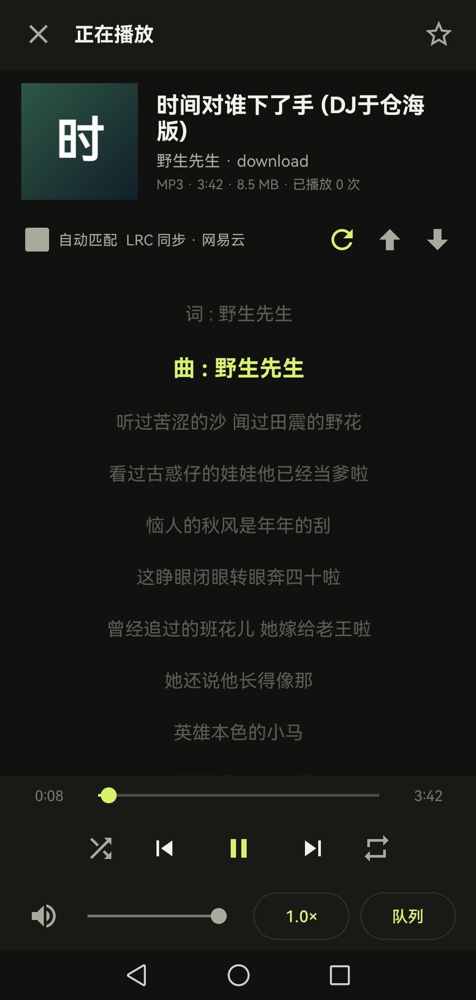
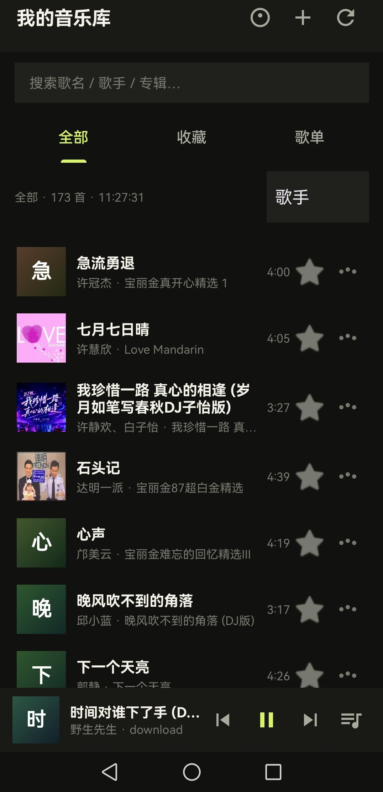
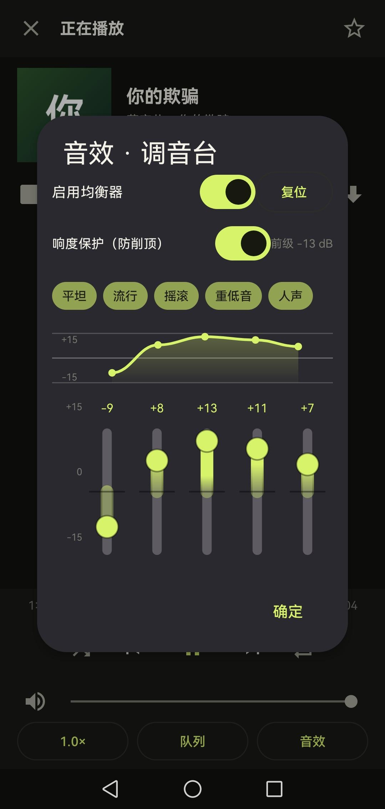

# 🎵 AI-Native-Music-Player

一个用「聊天版 AI 逐步升级调试」手搓出来的纯原生 Android 本地音乐播放器。

## ✨ 核心特性

- **纯原生开发**：拒绝套壳 WebView，体积小、启动快、极致省电流畅。
- **🎤 本地歌词支持**：自动解析 LRC 歌词文件，支持应用内滚动显示，沉浸式听歌。
- **🎛️ 高颜值调音台**：自定义 View 绘制的五段垂直均衡器，自带贝塞尔曲线实时联动，荧光绿暗黑配色。
- **🔊 响度保护**：内置前级 -13dB 防削顶机制，保护听力，杜绝音频爆音。
- **🔋 专治杀后台**：完美解决 OPPO / ColorOS 等系统“息屏播放完一首就停”的痛点，息屏无缝续播。
- **🔒 完全本地**：不联网，不请求任何敏感权限，无广告，绝对隐私。

## 📱 应用截图

## 📱 怎么体验？

点击 [Releases](https://github.com/yydsyangwei/natuve-music-player/releases) 标签页，下载最新 APK 直接安装即可（支持 Android 5.0+）。

## 🤖 开发故事

本项目没有手写一行代码，完全是由开发者通过自然语言与聊天版 AI 沟通，经历了“UI 绘制 -> 自定义控件 -> 音频底层 API 对接 -> OPPO 后台保活 -> 歌词解析”的逐步升级调试过程。

开发者通过提交 Logcat 报错日志，一步步引导 AI 修复问题，最终在真机上实现了完美运行。

## 🛠️ 技术栈

- 语言：Kotlin / Java
- 音频：Android AudioEffect (Equalizer, LoudnessEnhancer)
- UI：自定义 View & Canvas 绘制
- 后台：Foreground Service & WakeLock
- 歌词：LRC 文件解析器

*如果你也有息屏杀后台的烦恼，下载试试看，觉得不错请点个 Star 支持一下！*
